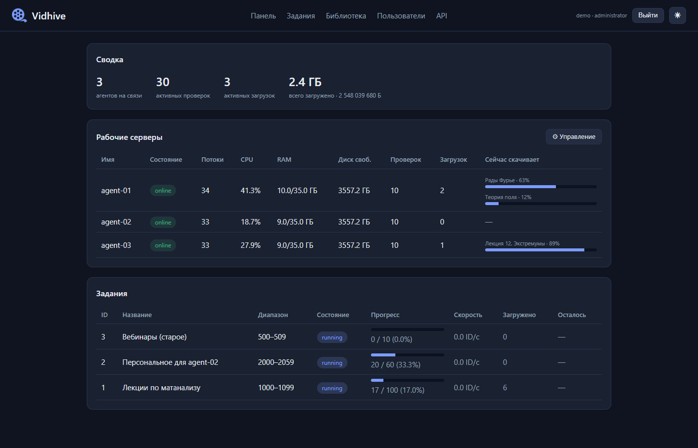
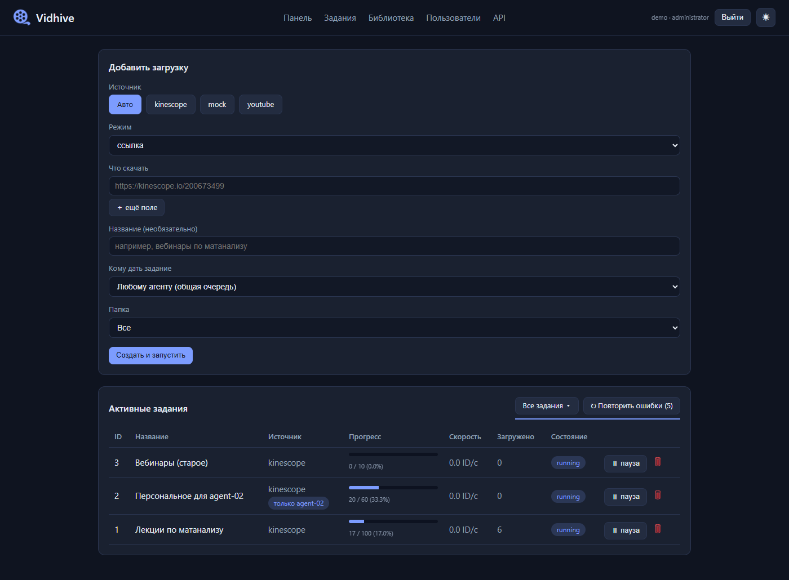
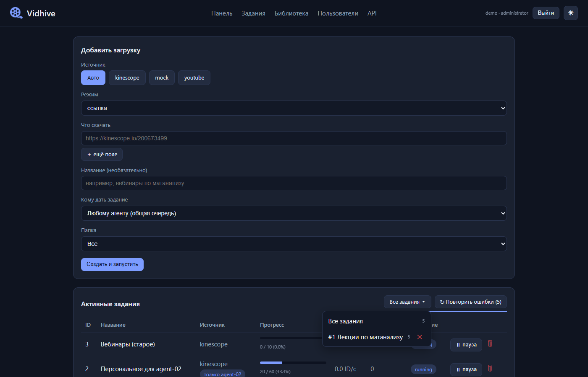
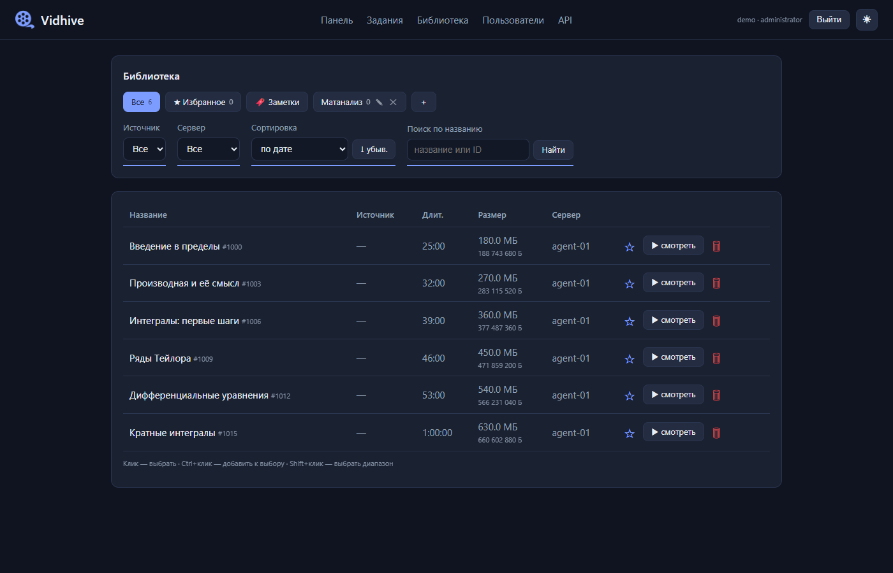
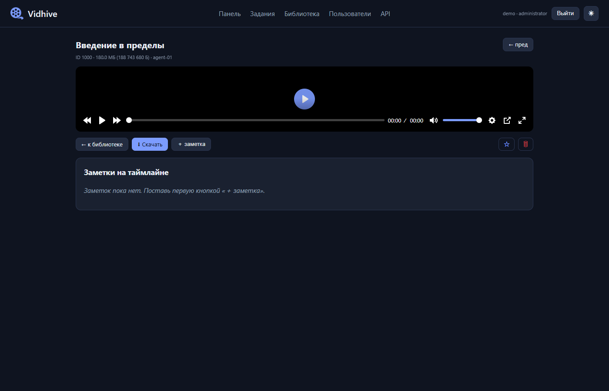
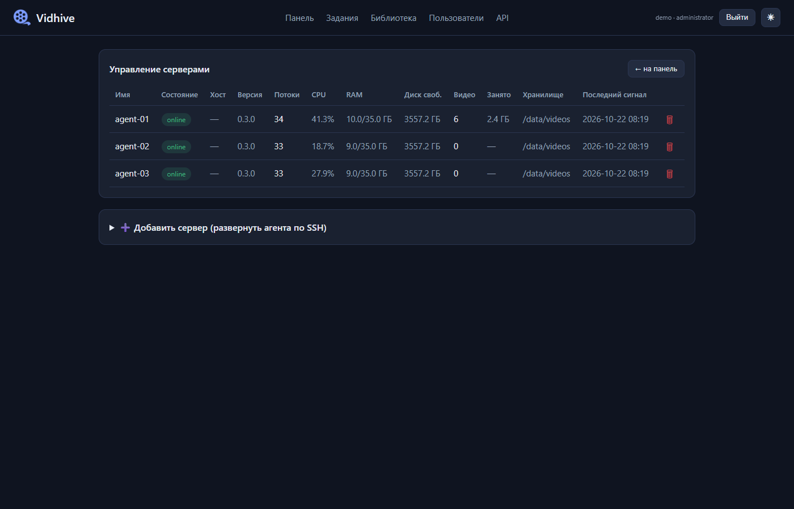
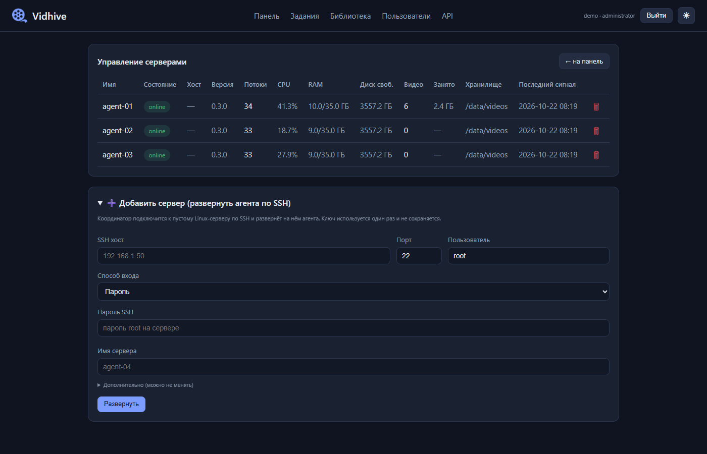
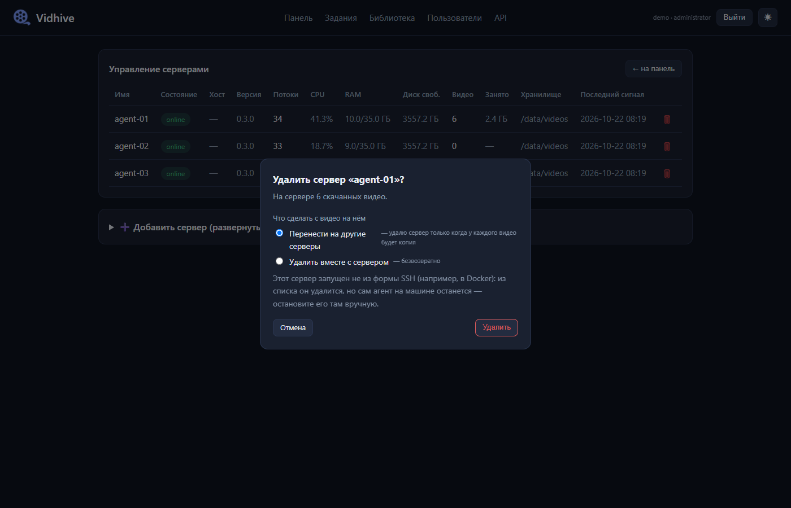
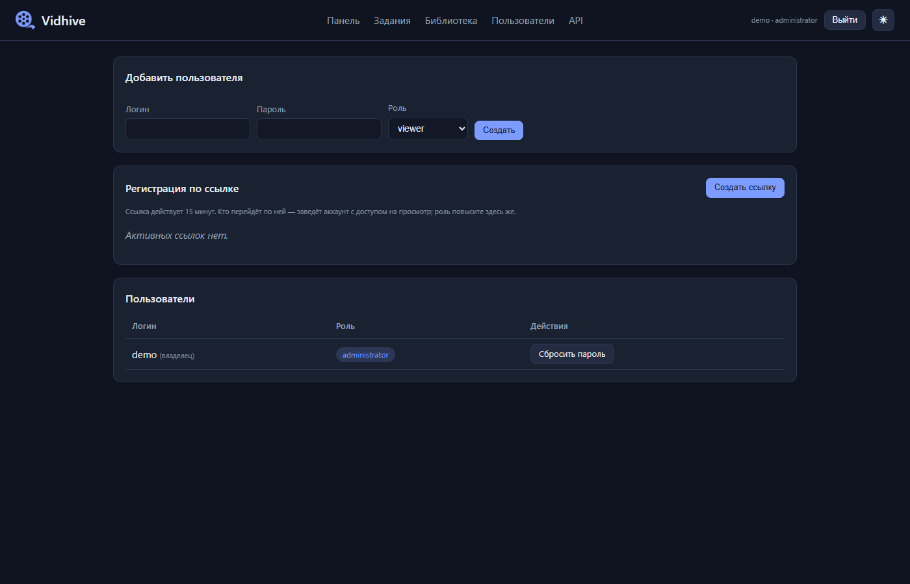

# Vidhive — полное описание приложения

Документ объясняет, **что такое Vidhive, как оно работает внутри и из чего состоит код**: архитектуру, жизненный цикл задания, протокол между координатором и агентами, безопасность, развёртывание, а также используемые библиотеки, модули и таблицы базы данных.

> Состояние на 22.10.2026. Автотесты: 262 у координатора и 24 у агента.

---

## 1. Что это и зачем

**Vidhive** — распределённая система поиска и скачивания видео. Её задача: взять большой диапазон идентификаторов (например, `1 … 10 000 000`) или список ссылок, проверить, какие из них существуют, и скачать найденные видео в лучшем качестве. Работа раздаётся нескольким серверам-агентам, поэтому она идёт параллельно и не останавливается, если один из серверов выключился.

Все скачанные видео собираются в единую **библиотеку** с веб-плеером. Всё управляется через **веб-интерфейс**.

Два режима работы:

1. **Сканирование диапазона** — перебор идентификаторов (`id`, `диапазон`) и загрузка всего, что нашлось.
2. **Загрузка по запросу** — конкретная ссылка (kinescope, YouTube, плейлист YouTube).

Поддерживаемые источники:

| Источник | Что принимает | Как скачивается |
|---|---|---|
| `kinescope` | число, диапазон, ссылка | шаблон `https://kinescope.io/{id}` + yt-dlp |
| `youtube` | только ссылка (в т.ч. плейлист) | yt-dlp по точной ссылке |
| `mock` | число, диапазон | тестовый сервис `http://mock:8090/{id}` для безопасных проверок |
| `auto` | ссылка | источник определяется по адресу ссылки |

### 1.1. Как это выглядит

> Скриншоты сделаны на демонстрационных данных (вымышленные агенты и видео).

**Панель** — сводка, рабочие серверы с живым прогрессом скачивания и активные задания:



**Задания** — форма «Добавить загрузку» (в том числе выбор агента), таблица заданий, кнопка «Повторить ошибки» с выпадающим списком, где у каждого задания есть ✕:





**Библиотека** — все скачанные видео с поиском, папками и фильтрами:



**Плеер** с личными заметками на таймлайне:



**Серверы** — таблица агентов и добавление сервера по SSH:





Единый диалог удаления сервера (перенос видео, удаление, снос агента с машины):



**Пользователи** — роли, приглашения:



---

## 2. Архитектура

### 2.1. Компоненты

```
                 браузер (HTML + JS, SSE)
                          │
                          ▼
   ┌──────────────────────────────────────────┐
   │ coordinator (FastAPI)                    │
   │  • веб-интерфейс (Jinja2)                │
   │  • REST API (/api/*)                     │
   │  • планировщик блоков (scheduler)        │
   │  • фоновая «уборка» (sweeper)            │
   │  • SSH-развёртывание агентов             │
   └───────────┬──────────────────────────────┘
               │ SQLAlchemy (async)
               ▼
        PostgreSQL ◄──── состояние: задания, блоки, видео, пользователи
               ▲
               │ HTTP (REST), токен X-Agent-Token
   ┌───────────┴───────────┬───────────────────┐
   │ agent-01              │ agent-02 … agent-N│  (на любом Linux-сервере)
   │  • берёт блоки        │                   │
   │  • проверяет и качает │                   │
   │  • отдаёт файлы /files│                   │
   └───────────────────────┴───────────────────┘
```

| Компонент | Роль |
|---|---|
| **coordinator** | «Мозг» и сайт. Хранит состояние, нарезает работу на блоки, выдаёт их агентам, показывает панель, библиотеку, плеер, управляет серверами и пользователями. |
| **postgres** | Единственный источник достоверного состояния. |
| **agent** | Рабочий сервер. Сам приходит за блоком, проверяет идентификаторы, скачивает видео, сообщает прогресс и отдаёт готовые файлы. |
| **mock** | Тестовая «мишень», имитирующая ответы 200 / 404 / 403 / 429 / 500. |
| **tunnel** (необязательно) | Cloudflare Quick Tunnel для публичной ссылки. |
| **common** (`vidhive_common`) | Общий пакет: схемы запросов/ответов и статусы, используется и координатором, и агентом. |

### 2.2. Ключевой принцип: блоки и аренда (lease)

Координатор **не отправляет** работу агентам — **агенты сами приходят за ней**. Диапазон нарезается на небольшие **блоки** (`range_chunks`). Агент просит блок (`/lease`), получает его **в аренду на ограниченное время** и пока работает, продлевает аренду сигналами `heartbeat`. Если агент пропал (выключился, потерял сеть), аренда истекает, и блок возвращается в очередь — его возьмёт другой агент.

Преимущества такой схемы: масштабирование (добавил сервер — стало быстрее), самовосстановление после отказов, равномерная загрузка (кто быстрее, тот берёт больше).

Обработка идёт по модели **at-least-once** с идемпотентными записями: один и тот же идентификатор может быть обработан дважды после сбоя, но результат от этого не портится (записи «upsert» по паре `job_id + external_id`).

---

## 3. Жизненный цикл задания

### 3.1. Создание

Страница **«Задания» → «Добавить загрузку»**: выбирается источник, режим (ссылка / id / диапазон), значения, название, папка библиотеки и (необязательно) **агент**, которому отдаётся задание.

Из формы собираются **цели** (`job_targets`): диапазон, одиночный id или ссылка. Для YouTube ссылка превращается в стабильный числовой идентификатор (хэш 11-символьного id видео), чтобы видео встроилось в общий конвейер (дедупликация, библиотека, заметки); плейлист раскрывается на отдельные видео.

### 3.2. Нарезка на блоки

При старте задания (`scheduler.initialize_job_chunks`):

- **Конечные диапазоны и одиночные id** — сразу нарезаются на блоки автоматического размера: примерно **4 блока на каждый онлайн-агент**, не больше 10 000 идентификаторов в блоке. Так даже один id или маленький диапазон распределяется между агентами.
- **Открытый диапазон** (`[A,]`) — блоки режутся «лениво» по мере запросов (размер по умолчанию 5000).
- **Ссылки (YouTube)** — один блок на видео, с точной ссылкой внутри блока.

Допустимые форматы диапазона (`vidhive_common.ranges.parse_range`): `[A,B]`, `A` (= 0…A), `[A,]` (от A без конца), пусто (= 0…∞).

### 3.3. Аренда и обработка блока

1. Агент вызывает `POST /api/workers/{id}/lease`. Координатор атомарно выбирает свободный блок запросом `SELECT … FOR UPDATE SKIP LOCKED` — один блок **никогда не выдаётся двум агентам**.
2. Блоки персональных заданий достаются только своему агенту; агент в состоянии `draining` и агент с нехваткой места (< 5 ГБ) блоков не получают.
3. Агент обрабатывает блок **пачками по 10 идентификаторов** параллельно (ограничение — число потоков). После каждой пачки отправляет `progress` с контрольной точкой `next_id`: при сбое теряется не больше одной пачки.
4. Для каждого идентификатора выполняются этапы:
   - **Проверка**: HTTP GET по шаблону. `404/410` → `not_found`; `401/403` → `forbidden`; `429` → ожидание (`Retry-After`) и повтор; `5xx` и таймауты → повтор с экспоненциальной паузой и «дрожанием» (jitter), затем `retry_wait`.
   - **Метаданные**: если страница есть (`200`), yt-dlp без скачивания подтверждает, что там реальное видео (название, длительность, размер).
   - **Загрузка** (`found` → `completed`): yt-dlp скачивает лучшие видео+аудио, `ffmpeg` склеивает в mp4; фрагменты HLS тянутся параллельно (8 потоков). Результат: `{хранилище}/{id // 1 000 000}/{id}/video.mp4` и `metadata.json`.
5. По завершении блока агент вызывает `complete`. Задание считается готовым, когда все блоки выполнены (`maybe_complete_job`; страховочная проверка каждые 15 секунд).

### 3.4. Статусы

| Объект | Статусы |
|---|---|
| Задание (`JobState`) | created → running → pausing → paused → stopping → stopped → completed / failed |
| Блок (`ChunkStatus`) | pending → leased → completed / failed |
| Идентификатор (`ItemStatus`) | pending, checking, not_found, found, downloading, completed, forbidden, rate_limited, retry_wait, failed, cancelled (+ skipped, download_queued) |
| Агент (`WorkerState`) | online, degraded, offline, **draining** |

Паузу, возобновление и остановку можно ставить в любой момент: агент узнаёт об этом в ответе на `progress` (`proceed = false`) и останавливается после текущей пачки.

### 3.5. Повтор ошибок

Идентификаторы со статусами `failed`, `rate_limited`, `retry_wait` попадают в список повторов. Кнопка **«↻ Повторить ошибки»** создаёт для каждого отдельный блок из одного id и перезапускает **только его** — уже скачанное повторно не качается. Выпадающий список выбирает область (все задания или одно); **✕** рядом с заданием убирает его ошибки из повторов (статус `cancelled`, в прогрессе они остаются засчитанными).

---

## 4. Надёжность и отказоустойчивость

| Механизм | Как работает |
|---|---|
| **Heartbeat** | Агент шлёт сигнал каждые 5 с: нагрузка CPU/RAM, свободный диск, число проверок/загрузок, активный блок, прогресс загрузок. Координатор продлевает аренду **только активного** блока. |
| **Просрочка аренды** | Блок с истёкшей арендой возвращается в очередь (`reclaim_expired`). |
| **Офлайн-детектор** | Агент, молчащий 30 с, помечается `offline` (`mark_stale_workers`). |
| **Фенсинг (fencing)** | Если блок уже передан другому, «опоздавший» агент получает `409 StaleLease` и прекращает работу над ним; запись результата от устаревшей аренды не принимается. |
| **Идемпотентность** | `complete` повторяется безопасно; элементы пишутся по `(job_id, external_id)`. |
| **Пауза/остановка** | Агент останавливается по `proceed=false`; состояние возобновляется с контрольной точки. |
| **Лимиты** | Глобальный лимит запросов в секунду на агента (token bucket), повторы с `Retry-After`. |
| **Место на диске** | Агент с менее чем 5 ГБ свободного места блоков не получает. |
| **Перезапуск** | Все контейнеры стенда имеют `restart: unless-stopped`. |

### Перенос видео при удалении сервера (draining)

Раньше «распределить» сразу стирало исходные копии, и неудачная повторная загрузка теряла видео. Теперь сервер получает состояние `draining`: он не берёт новую работу, но продолжает отдавать свои файлы; для видео, существующих **только** на нём, ставится задание «Перенос с …»; когда у каждого видео появилась копия на другом сервере, координатор удаляет сервер. Если перенос не удался — всё остаётся на месте.

---

## 5. Управление серверами

Страница **«Серверы»** (только администратор): таблица агентов (состояние, версия, потоки, CPU, RAM, диск, число видео, занято места, хранилище, последний сигнал).

### 5.1. Добавление сервера по SSH

Нужен **только IP, SSH-порт и пароль (или приватный ключ)** — на сервере ничего не должно быть заранее. Координатор по SSH (библиотека `asyncssh`) запускает скрипт `deploy/agent-bootstrap.sh`, который:

1. определяет менеджер пакетов (apt / dnf / yum / zypper / apk) и ставит `python3`, `ffmpeg`, `git`;
2. клонирует репозиторий в `/opt/vidhive`, создаёт виртуальное окружение и ставит зависимости агента;
3. записывает конфигурацию в `/etc/vidhive-agent.env` (адрес координатора, имя, потоки, путь хранилища, токен);
4. регистрирует службу `systemd` (или, если `systemd` нет, запускает процесс через `nohup`).

Вывод установки в реальном времени показывается на странице журнала. SSH-ключ и пароль **нигде не сохраняются**.

Поля формы: хост, порт, пользователь, способ входа (пароль / ключ), имя сервера. В «Дополнительно»: потоки и адрес агента (по умолчанию `http://<хост>:8100`). Путь хранилища всегда стандартный `/var/lib/vidhive/videos` (должен содержать каталог `vidhive*` — защита скриптов удаления).

Адрес координатора, который получает агент, берётся из настройки `VIDHIVE_PUBLIC_URL`, а если она пуста — из адреса, по которому админ открыл страницу.

### 5.2. Единое удаление сервера

Одна корзина, один диалог. Выбор:

- **что с видео**: перенести на другие серверы (через `draining`) или удалить вместе с сервером;
- **для серверов, установленных по SSH**: дополнительно **полностью снести агента с машины** (`agent-teardown.sh`: остановка службы, удаление `/opt/vidhive`, конфига, хранилища и пустой родительской папки; контроль процессов через `/proc`).

Если выбраны «перенести» и «снести с машины», машина стирается **только после** того, как у каждого видео появилась копия; ход виден в журнале. Агенты из Docker Compose удаляются только из списка (агент остаётся на машине).

### 5.3. Персональные задания

В форме задания можно выбрать «только <агент>»: блоки такого задания получает исключительно этот агент (поле `jobs.assigned_worker_id`). Если агент выключен, задание ждёт его; если агента удалить, задание становится общим.

### 5.4. Прогресс скачивания на панели

Агент измеряет прогресс yt-dlp (видео и аудио — отдельные потоки, процент усредняется и не идёт назад) и передаёт его в heartbeat. Координатор держит эти данные **только в памяти** (`services/activity.py`), страница «Панель» опрашивает `/api/workers/activity` каждые 2,5 с и рисует полоску для каждого агента.

---

## 6. Библиотека, плеер, заметки

- **Библиотека**: каждое видео показывается один раз (новейшая копия), поиск по названию и id, фильтры по источнику, папке и серверу, сортировка по дате/названию/длительности/размеру/серверу.
- **Папки** (группы): пользовательские, «Избранное» создаётся автоматически; видео можно раскладывать по папкам; задание может сразу складывать найденное в папку.
- **Просмотр и скачивание**: координатор берёт файл у нужного агента (`GET /files/{id}`, с токеном) и отдаёт браузеру потоком; «Скачать» отдаёт файл как вложение.
- **Плеер** (Plyr): скорость 0.5×–2×, перемотка по 10 с, режим «картинка в картинке», AirPlay, полный экран, горячие клавиши.
- **Личные заметки**: метка с временем, ставится на таймлайн, переход по клику, редактирование и удаление. Заметки личные (у каждого пользователя свои).

### 6.1. Как видео попадает из агента в браузер

Коротко: **видео не нарезается на сегменты по дороге к браузеру.** Это один готовый файл `video.mp4`, который браузер читает кусками по HTTP.

**Шаг за шагом:**

1. **Загрузка.** Источник (Kinescope) отдаёт видео как HLS — плейлист из сотен маленьких фрагментов. Агент (yt-dlp) скачивает **все** фрагменты и `ffmpeg` склеивает их вместе с аудио в **один файл** `video.mp4` на диске агента: `{хранилище}/{id // 1 000 000}/{id}/video.mp4`.
2. **Открытие плеера.** Страница `/player/{id}` содержит обычный тег `<video>` с адресом `/watch/{id}` (поверх него — Plyr: кнопки, скорость, заметки).
3. **Запрос байтов.** Браузер запрашивает `/watch/{id}` с заголовком `Range: bytes=0-`. Координатор находит агента, у которого лежит файл, и пересылает запрос агенту: `GET /files/{id}` с тем же `Range` и токеном агента.
4. **Ответ.** Агент отдаёт нужный кусок файла (`206 Partial Content`), координатор **потоком** (без загрузки всего файла в память) передаёт его браузеру.
5. **Подгрузка вперёд и перемотка.** Сколько читать наперёд (обычно десятки секунд — пара минут), решает сам браузер: он держит буфер и дочитывает файл, пока вы смотрите. При перемотке браузер шлёт новый `Range` с нужным смещением, и воспроизведение продолжается с этого места, не скачивая всё остальное.

**Сравнение с YouTube, Netflix и т.п.** Эти платформы используют **адаптивный стриминг (HLS/DASH)**: видео заранее нарезано на сегменты по несколько секунд в нескольких качествах, плеер подгружает сегменты вперёд и сам переключает качество под скорость сети. У нас иначе:

| | Платформы (HLS/DASH) | Vidhive |
|---|---|---|
| Формат на сервере | сотни сегментов в нескольких качествах | один файл `.mp4` одного (лучшего) качества |
| Подгрузка вперёд | плеер по плейлисту | браузер через HTTP Range |
| Смена качества на лету | да | нет |
| Перекодирование | да | нет (файл отдаётся как есть) |
| Сложность | высокая | низкая |

То есть «подгрузка на пару минут вперёд» у нас есть, но её обеспечивает не специальный формат, а обычная буферизация браузера поверх HTTP Range. Для библиотеки личных лекций этого достаточно; адаптивное качество нужно было бы для тысяч зрителей.

**Важные особенности:**
- Весь поток идёт **через координатор** (браузер с агентом напрямую не общается). Это позволяет проверять роли и токен в одном месте и работать с агентами за закрытой сетью, но означает, что пропускная способность координатора — узкое место при многих зрителях.
- Если агент выключен, его видео недоступны для просмотра (ответ `502`) — пока он не вернётся или видео не перенесено на другой сервер.
- Не проверено: лежит ли служебная информация mp4 (`moov`) в начале файла. Если в конце, браузеру нужен один дополнительный запрос `Range` к концу файла перед стартом — это работает, но старт может быть чуть медленнее.

---

## 7. Доступ и безопасность

### 7.1. Пользователи и роли

| Роль | Права |
|---|---|
| `viewer` | смотреть панель, библиотеку, плеер, заметки |
| `operator` | + создавать и управлять заданиями, библиотекой |
| `administrator` | + серверы, SSH-развёртывание, пользователи, приглашения |

- **Мастер первого запуска** (`/setup`): при пустой базе первый посетитель создаёт администратора. Администратора можно также задать переменными окружения.
- **Главный пользователь** (самый ранний, с наименьшим id) защищён: его нельзя ни понизить, ни удалить.
- **Ссылки-приглашения**: администратор создаёт индивидуальную ссылку, действует 15 минут, выдаёт минимальную роль `viewer`; затем администратор может повысить роль.
- **Пароли**: PBKDF2-SHA256, 240 000 итераций, соль, сравнение за постоянное время; хэширование вынесено в отдельный пул потоков, чтобы не блокировать сервер.
- **Сессии**: подписанные cookie (Starlette `SessionMiddleware` + `itsdangerous`); флаг `Secure` ставится автоматически при https.
- **Защита входа**: ограничение попыток — 5 на пару «адрес + логин» и 30 на адрес за 5 минут (ответ 429); одинаковое время ответа для неизвестного пользователя и неверного пароля.

### 7.2. Защита связи агентов

- **Токен агента** `VIDHIVE_AGENT_TOKEN` (заголовок `X-Agent-Token`, сравнение за постоянное время): закрывает машинные эндпоинты координатора (`register/lease/progress/heartbeat/complete/fail`) и файловые эндпоинты агента (`/files/*`).
- **Проверка адреса агента** (защита от SSRF): при регистрации адрес проверяется (`validate_agent_url`).

### 7.3. Защита веб-части

- Пользовательский текст никогда не подставляется в JavaScript: данные передаются атрибутами `data-*` (защита от XSS); тесты проверяют это.
- Заголовки: `Content-Security-Policy`, `X-Frame-Options: DENY`, `X-Content-Type-Options: nosniff`, `Referrer-Policy`.
- **Путь хранилища** в скриптах установки/удаления проверяется (абсолютный, без `..`, обязательно внутри каталога `vidhive*`) — `rm -rf` от root никогда не коснётся чужих папок.

### 7.4. Публичная ссылка (туннель)

Запрос считается **публичным**, если он пришёл через туннель/прокси (заголовки `CF-Connecting-IP`, `X-Forwarded-For` и т.п.) или с глобального адреса. При `VIDHIVE_RESTRICT_PUBLIC=true` публичные запросы не могут открывать административные страницы, завершать `/setup` и видеть `/docs`; ограничение попыток входа считается по реальному адресу посетителя. Дополнительно параметр `VIDHIVE_PUBLIC_ADMIN` решает, **кто** может открывать админские страницы через публичную ссылку: `none` — никто (по умолчанию), `owner` — только главный администратор (первый созданный аккаунт), `any` — любой администратор. На домашнем стенде выбран режим `owner`: зрители и операторы работают через публичную ссылку в рамках своих ролей, управление серверами и пользователями доступно только главному администратору (остальные администраторы — из домашней сети или по Tailscale).

---

## 8. Обновления в реальном времени

- **SSE** (`/events/stream`): внутрипроцессная шина (`services/bus.py`) будит все открытые страницы после каждого успешного изменения (POST/PUT/PATCH/DELETE). Страница заново запрашивает только свой фрагмент (`/fragments/dashboard`, `/fragments/jobs`, `/fragments/servers`) — частичное обновление без перезагрузки.
- Heartbeat и lease специально **не** вызывают обновление (слишком частые); для них — отдельный опрос (`/api/workers/activity`).
- Шина работает в одном процессе координатора, этого достаточно для одного экземпляра.

---

## 9. Состав кода

### 9.1. Структура репозитория

```
Vidhive/
├── coordinator/          # координатор: API + сайт + планировщик (≈ 6 400 строк: Python и шаблоны)
│   ├── app/
│   │   ├── main.py            # создание приложения, middleware, фоновая уборка
│   │   ├── core/              # config.py (настройки), sources.py (источники)
│   │   ├── db/                # models.py (таблицы), session.py, base.py
│   │   ├── api/               # REST: jobs, workers, library, notes, health
│   │   ├── services/          # бизнес-логика (см. ниже)
│   │   └── web/               # router.py (страницы), templates/, static/
│   ├── alembic/versions/      # 10 миграций БД
│   ├── tests/                 # автотесты координатора
│   └── Dockerfile, entrypoint.sh
├── agent/                # агент: проверка, загрузка, отдача файлов
│   ├── app/ main.py, worker.py, checker.py, coordinator_client.py, ratelimit.py, core/config.py
│   └── tests/
├── common/               # общий пакет vidhive_common (enums, schemas, ranges)
├── mock/                 # тестовая «мишень»
├── deploy/               # docker-compose.yml, .env.example, agent-bootstrap.sh, agent-teardown.sh
├── docs/                 # документация, спецификации, планы
└── README.md
```

### 9.2. Модули координатора

| Файл | Назначение |
|---|---|
| `main.py` | `create_app()`: подключает роутеры, middleware (сессии, текущий пользователь, заголовки безопасности, Secure-cookie), обработчик ошибок доступа; `lifespan` создаёт роли и первого админа и запускает фоновую уборку каждые 15 с (завершение заданий, офлайн-агенты, завершение переноса, чистка метрик). |
| `services/scheduler.py` | **Ядро**: нарезка блоков, аренда (`lease_chunk`), продление (`renew_worker_leases`), запись прогресса (`apply_progress`), завершение блока (`complete_chunk`), возврат просроченных (`reclaim_expired`), повтор ошибок (`requeue_failed_items`), завершение задания (`maybe_complete_job`), фенсинг (`StaleLease`). |
| `services/drain.py` | Перенос видео перед удалением сервера: `start_drain`, `unmigrated_items`, `purge_worker`, `finalize_drained_workers`. |
| `services/deployer.py`, `deployments.py` | SSH-развёртывание/снос через `asyncssh`, потоковый журнал в памяти. |
| `services/auth.py`, `security.py`, `ratelimit.py` | Роли и защитные зависимости (`require_role`, `require_agent_token`), хэширование паролей, ограничение попыток входа. |
| `services/netinfo.py` | Определение «публичный запрос / домашний», реальный адрес посетителя, https. |
| `services/agent_client.py` | Заголовки с токеном к агентам, проверка адресов агентов. |
| `services/youtube.py` | Разбор ссылок YouTube, раскрытие плейлистов, числовой идентификатор. |
| `services/bus.py`, `activity.py`, `events.py` | SSE-шина, живой прогресс загрузок, журнал событий. |
| `api/jobs.py` | `/api/jobs`: создание, старт/пауза/продолжение/остановка, повтор ошибок, список элементов и событий, убирание ошибок. |
| `api/workers.py` | `/api/workers`: регистрация, heartbeat, lease, progress, complete, fail, удаление, активность. |
| `api/library.py`, `notes.py` | Библиотека, группы, избранное; личные заметки. |
| `web/router.py` | Все страницы сайта (вход, мастер, пользователи, серверы, задания, библиотека, плеер, фрагменты, SSE). |
| `web/templates/` | Шаблоны Jinja2: `base.html` (каркас, диалоги, иконка), `index.html`+`_dashboard.html`, `jobs.html`+`_jobs_table.html`, `servers.html`+`_servers_table.html`, `library.html`, `watch.html`, `users.html`, `login/register/setup.html`, `deploy_log.html`. |
| `web/static/` | Plyr, логотип, favicon. |

### 9.3. Модули агента

| Файл | Назначение |
|---|---|
| `main.py` | FastAPI-приложение агента: `/health`, `GET/DELETE /files/{id}` (с проверкой токена), запуск рабочего цикла. |
| `worker.py` | `WorkerRunner`: регистрация, цикл аренды, heartbeat, обработка блока пачками, остановка по `proceed=false` и 409. |
| `checker.py` | Проверка идентификатора (повторы, backoff), метаданные и загрузка через yt-dlp, прогресс-хук. |
| `coordinator_client.py` | Клиент API координатора (`httpx`). |
| `ratelimit.py` | Асинхронный token-bucket для лимита запросов в секунду. |
| `core/config.py` | Настройки из переменных окружения (`VIDHIVE_*`). |

### 9.4. Общий пакет `vidhive_common`

`enums.py` (статусы и роли), `schemas.py` (Pydantic-модели: `JobCreate/JobOut`, `WorkerRegister/WorkerOut`, `ChunkLease`, `ProgressReport/ProgressAck`, `ItemResult`, `Heartbeat`, `DownloadProgress`, …), `ranges.py` (разбор диапазонов).

### 9.5. Библиотеки

| Библиотека | Версия | Для чего |
|---|---|---|
| Python | 3.12 | язык |
| FastAPI | 0.115.6 | REST API и веб-страницы |
| Uvicorn | 0.34.0 | ASGI-сервер |
| Starlette | (с FastAPI) | сессии, middleware, статические файлы |
| SQLAlchemy | 2.0.36 | ORM, асинхронный доступ к БД |
| asyncpg | 0.30.0 | драйвер PostgreSQL (приложение) |
| psycopg2-binary | 2.9.10 | драйвер для миграций |
| Alembic | 1.14.0 | миграции схемы БД |
| Jinja2 | 3.1.5 | шаблоны страниц |
| Pydantic / pydantic-settings | 2.10.4 / 2.7.1 | схемы, настройки из окружения |
| httpx | 0.28.1 | асинхронные HTTP-запросы (проверка id, связь агент↔координатор) |
| yt-dlp | 2026.8.19 (координатор), 2024.12.13 (агент) | разбор ссылок, метаданные, загрузка |
| ffmpeg | системный | склейка видео и аудио |
| asyncssh | 2.24.0 | SSH-развёртывание |
| itsdangerous | 2.2.0 | подпись cookie сессий |
| python-multipart | 0.0.20 | разбор HTML-форм |
| psutil | 6.1.1 | метрики CPU/RAM/диска на агенте |
| pytest | 8.3.4 | тесты (`aiosqlite` для тестовой БД) |
| Plyr | (в `static/`) | видеоплеер в браузере |
| Docker / Docker Compose | — | запуск стенда |

Примечание: версия yt-dlp у агента старше, чем у координатора, — при проблемах с загрузкой её стоит обновить.

### 9.6. Таблицы базы данных (PostgreSQL)

| Таблица | Содержимое |
|---|---|
| `users`, `roles`, `user_roles` | учётные записи и их роли |
| `invites` | одноразовые ссылки-приглашения |
| `jobs` | задания (источник, диапазон, состояние, размер блока, папка, `assigned_worker_id`) |
| `job_targets` | цели задания: диапазон, id или ссылка |
| `range_chunks` | блоки: диапазон, контрольная точка `next_id`, статус, кто арендовал, срок аренды, ссылка |
| `items` | по строке на идентификатор: статус, агент, попытки, последняя ошибка |
| `media_metadata` | название, ссылка, длительность, размер, источник |
| `downloads`, `files` | сведения о загрузках и файлах |
| `workers`, `worker_metrics` | агенты (адрес, потоки, хранилище, состояние) и их метрики |
| `agent_deployments` | как сервер был развёрнут по SSH (хост, порт, пользователь, пути) — без паролей и ключей |
| `groups`, `item_groups` | папки библиотеки и привязка видео |
| `notes` | личные заметки к видео |
| `events` | журнал событий |
| `audit_log`, `job_workers` | зарезервированы (пока не используются) |

### 9.7. REST API (основное)

| Метод и путь | Назначение | Доступ |
|---|---|---|
| `POST /api/jobs` | создать задание | operator |
| `POST /api/jobs/{id}/start · pause · resume · stop` | управление заданием | operator |
| `POST /api/jobs/{id}/retry`, `/api/jobs/retry-all` | повторить ошибки | operator |
| `POST /api/jobs/errors/dismiss-all?job_id=` | убрать ошибки из повторов | operator |
| `GET /api/jobs`, `/{id}`, `/{id}/items`, `/{id}/events` | чтение | viewer |
| `DELETE /api/jobs/{id}` | остановить и удалить с видео | operator |
| `POST /api/workers/register · {id}/lease · progress · complete · fail · heartbeat` | протокол агента | токен агента |
| `GET /api/workers`, `/{id}`, `/activity` | чтение агентов и живого прогресса | viewer |
| `DELETE /api/workers/{id}?mode=purge\|redistribute` | удалить агента | administrator |
| `GET /api/all`, `/api/groups` (+ создание/правка/удаление), `/api/notes` | библиотека, папки, личные заметки | по ролям |
| `GET /health` | проверка состояния | открыт |

### 9.8. Основные страницы сайта

`/` панель · `/jobs` задания · `/library` библиотека · `/watch/{id}` плеер · `/servers` серверы · `/servers/deploy/{id}` журнал развёртывания · `/users` пользователи · `/login`, `/register`, `/setup`.

### 9.9. Настройки (переменные окружения)

| Переменная | Значение |
|---|---|
| `VIDHIVE_DATABASE_URL` | адрес PostgreSQL |
| `VIDHIVE_SECRET_KEY` | ключ подписи сессий (если не задан, создаётся случайный на время работы) |
| `VIDHIVE_AGENT_TOKEN` | общий секрет координатора и агентов |
| `VIDHIVE_ADMIN_USER`, `VIDHIVE_ADMIN_PASSWORD` | необязательно: создать первого администратора из окружения |
| `VIDHIVE_RESTRICT_PUBLIC` | ограничения для запросов через туннель (по умолчанию `true`) |
| `VIDHIVE_PUBLIC_ADMIN` | кто открывает админку через публичную ссылку: `none` / `owner` / `any` |
| `VIDHIVE_EGRESS_GATEWAY` | шлюз (контейнер `vpn`), через который агенты выходят в интернет |
| `VIDHIVE_PUBLIC_URL` | адрес координатора для агентов, установленных по SSH |
| `VIDHIVE_WORKER_OFFLINE_SECONDS`, `VIDHIVE_MIN_FREE_SPACE_GB` | порог офлайна (30 с), порог свободного места (5 ГБ) |
| Агент: `VIDHIVE_COORDINATOR_URL`, `WORKER_NAME`, `THREADS`, `STORAGE_PATH`, `TARGET_TEMPLATE`, `RATE_LIMIT_RPS`, `AGENT_URL`, `AGENT_PORT`, `DOWNLOAD_FORMAT`, `FRAGMENT_CONCURRENCY` | параметры агента |

---

## 10. Развёртывание

`deploy/docker-compose.yml` поднимает: `postgres`, `coordinator` (порт 8000), `agent-01/02/03`, `mock` (порт 8090); профиль `tunnel` включает Cloudflare Tunnel. Конфигурация берётся из `deploy/.env` (образец — `.env.example`).

Типовой порядок обновления домашнего сервера (TrueNAS): отправить изменения в GitHub → на сервере `git pull` → `docker compose up --build -d`.

Агенты на посторонних серверах ставятся из веб-интерфейса (раздел 5.1); им нужен обычный Linux (Debian/Ubuntu/CentOS и т.п.). TrueNAS и подобные закрытые системы не подходят: в них запрещена установка пакетов.

---

## 11. Тестирование

- 262 теста координатора и 24 теста агента (pytest, тестовая БД SQLite через `aiosqlite`).
- Покрыто: протокол блоков и фенсинг, правила планировщика, роли и доступ, приглашения, ограничение входа, публичный режим, защита от XSS, перенос видео, SSH-развёртывание и снос (с подменой SSH), персональные задания, список ошибок, живой прогресс, разбор диапазонов, проверка скриптов.
- Живые проверки на стенде: установка агента по паролю на чистый Debian, снос по SSH, скачивание с настоящего Kinescope.

---

## 12. Известные ограничения

- Прямое скачивание с `youtube.com` с домашней сети стенда недоступно (блокировка сети); разбор ссылок работает.
- Публичная ссылка через Cloudflare Tunnel с домашней сети нестабильна; рабочий путь — Tailscale.
- Страница «Серверы» требует, чтобы агент, установленный по SSH, был доступен координатору по порту 8100 (файлы), а координатор — агенту (регистрация, блоки).
- Один экземпляр координатора (шина SSE, ограничение входа и журнал развёртываний хранятся в памяти процесса).
- Не реализованы: журнал действий администратора, ограничение размера таблицы событий, очередь повторной выдачи блоков «не тому же агенту».

---

## 13. Страница «API» (`/docs`)

Пункт «API» в меню открывает `/docs` — это **интерактивная справка по REST API**, которую FastAPI строит автоматически (Swagger UI; та же схема доступна как `/openapi.json`, альтернативный вид — `/redoc`). Она есть, потому что:

1. **REST API — основа системы.** Координатор управляется именно им: агенты общаются с ним через `/api/workers/*`, сайт использует `/api/jobs/*` и другие. Страница показывает все пути, параметры и форматы запросов и ответов — это готовая документация протокола.
2. **Проверка и демонстрация.** Прямо в браузере можно вызвать любой запрос кнопкой «Try it out» (под вашей текущей учётной записью): удобно для отладки и для показа преподавателю.
3. **Интеграции.** Если понадобится скрипт (создать задание, получить список агентов), по справке сразу видно, как его написать.
4. **Ничего не стоит.** Это бесплатная возможность фреймворка, отдельного кода для неё нет.

Для повседневной работы со скачиванием страница не нужна. Она закрыта для запросов через публичную ссылку (ответ 404), а в меню её можно скрыть для не-администраторов или убрать совсем.
